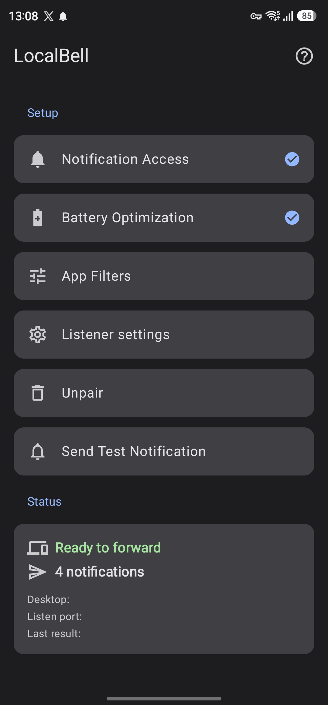
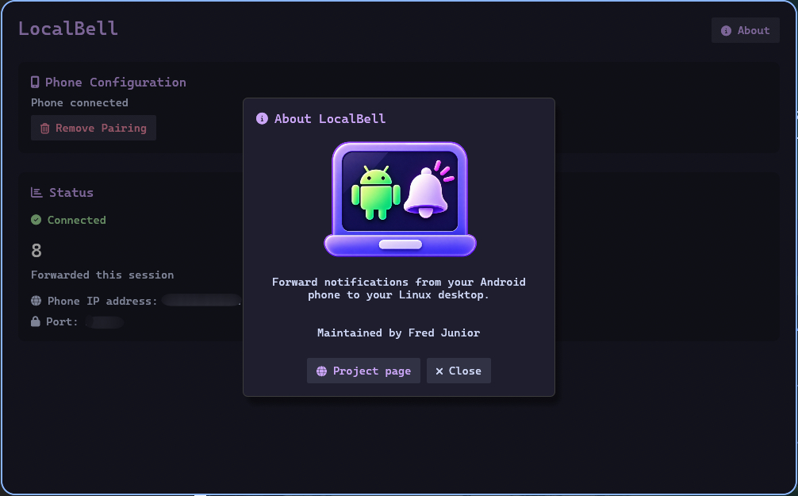

<p align="center">
  
</p>

<h1 align="center">LocalBell</h1>
<p align="center"><strong>Version 1.4.28</strong></p>

<p align="center"><strong>Forward Android notifications to your Linux desktop.</strong></p>

<p align="center">
  <a href="https://github.com/fredjunior54/localbell/actions/workflows/ci.yml">
    
  </a>
  <a href="https://github.com/fredjunior54/localbell/releases/latest">
    
  </a>
  
  
  
  <a href="LICENSE">
    
  </a>
</p>

<p align="center">
  <a href="assets/screenshot-android.jpg"></a>
  <a href="assets/screenshot-client.jpg"></a>
</p>

Maintained by **[Fred Junior](https://github.com/fredjunior54)**. LocalBell is a fork of **[LaNotifica](https://github.com/alessandrolattao/lanotifica)**, originally created by Alessandro Lattao.

## 🔔 How it works

1. Open LocalBell on Android. In **Listener settings**, check the port (default `19420`) and tap **Start listening** if needed. Allow local network access if prompted on Android 17 or later.
2. On Linux, enter the phone's IPv4 address or hostname and port under **Phone Configuration**, then select **Pair**. Compare the six-digit numbers. Tap **Numbers match** on Android, then approve on Linux.
3. Grant **Notification Access** on Android to forward eligible alerts automatically. Use **Send Test Notification** and check **Status** to verify delivery.

Linux initiates and maintains an encrypted session; Android makes no delivery attempts while disconnected. Both apps must be updated together when moving from the old HTTPS setup. Pair once again; app filters stay unchanged. See the [setup guide](docs/getting-started.md#connect-over-tailscale) for Tailscale.

## ✨ Features

- **Pair by address:** Enter the phone’s IP or hostname, compare a six-digit number, and approve. No QR scan or code entry.
- **Encrypted, direct delivery:** Notifications travel over certificate-pinned TLS on your LAN or Tailscale network. No account or cloud relay.
- **Native Linux notifications:** Get alerts through your desktop’s D-Bus notification service. Dismissing an alert on your phone also dismisses it on Linux.
- **Test delivery:** Send a sample to a ready desktop without granting notification access. Both counters include successful automatic and test deliveries, exclude failures and dismissals, and reset on reconnect. Linux shows its **Status** card only while authenticated.
- **Android app artwork:** Compatible Linux notification daemons can display the source app icon without a cloud lookup. Linux sends it directly over the session D-Bus.
- **Per-app filters:** Choose which Android apps can forward notifications.

## 🚀 Quick start

### 🐧 Desktop (Linux)

Download `localbell-X.Y.Z-linux-amd64.tar.gz` from [GitHub Releases](https://github.com/fredjunior54/localbell/releases/latest). From a terminal in your desktop session, extract and start it:

```bash
tar -xzf localbell-X.Y.Z-linux-amd64.tar.gz
./localbell
```

Run `./localbell --help` to list the CLI options or `./localbell --version` to print the installed version. Neither command opens a window.

Use `./localbell --start-minimized` to start in the system tray without opening the main window. If the tray is unavailable, LocalBell opens the window instead.

Configure the phone address and port in the desktop window. Click the tray icon to show or hide the window. Closing the window keeps the session active when a tray host is available; **Quit** stops LocalBell. GNOME may require the AppIndicator and KStatusNotifierItem Support extension.

Select **About** for the installed version and maintainer. **Project page** opens the LocalBell repository in your default browser.

#### 📦 Install for your user

If you started LocalBell manually, select **Quit** in the tray before installing so the service can take over. From a LocalBell source checkout, run the installer without `sudo`. It builds the optimized Linux client first (requires Make and Rust with Cargo), then installs it:

```bash
./install.sh
```

To skip compilation, extract a downloaded release archive and pass the binary path to the installer. Run the same command with a newer binary to upgrade:

```bash
./install.sh /path/to/extracted/localbell
```

The installer uses `packaging/localbell.desktop` and `packaging/localbell-user.service` and adds `~/.local/bin/localbell`, `~/.local/share/applications/localbell.desktop`, and `localbell.service` under `${XDG_CONFIG_HOME:-$HOME/.config}/systemd/user/`. The **LocalBell** launcher opens the window, including when the client is already running in the tray. It does not start a second client.

The user service starts LocalBell with `--start-minimized` once the graphical session is active and an up interface has a non-loopback IPv4 address. It stops at logout. The client keeps retrying if the phone is not yet reachable. If the graphical session is not active during installation, the service is enabled for the next supported graphical login. On desktops without systemd graphical session integration, use the launcher or run the standalone binary.

To stop and disable the user service and remove the installed files, run from the source checkout:

```bash
./uninstall.sh
```

Uninstalling preserves your pairing and configuration.

### 📱 App (Android)

Download and install `localbell-X.Y.Z.apk` from the same release. Android may ask you to allow installation from the app you used to open the APK. The listener binds IPv4 on port `19420` by default and rejects nonlocal peers before TLS. A wildcard bind is not VPN-only.

## 📋 Requirements

| Component   | Requirement                                                                          |
| ----------- | ------------------------------------------------------------------------------------ |
| **Desktop**  | Linux x86-64 with a Wayland or X11 desktop, OpenGL, and a D-Bus notification service |
| **App**     | Android 14 or later (API 34+)                                                        |
| **Network** | Both devices reachable on the same LAN or tailnet                                               |

The optional user installer needs a systemd user manager, `ip` (iproute2) and `xdg-open` (xdg-utils). Automatic startup needs a desktop that activates `graphical-session.target`. A system tray is needed to start with no window; the standalone binary does not require systemd or `ip`. Opening **Project page** requires `xdg-open` even when running standalone.

## 🔒 Security

- **TLS** encrypts notifications in transit. The Linux client pins the Android certificate verified during the numeric comparison.
- Only one desktop pairing is active. **Unpair** on Android revokes it even while the desktop is offline. Linux stores its paired phone configuration under `~/.config/localbell/` by default.

## 🛠️ Development

### 📦 Prerequisites

- A current stable Rust toolchain with Cargo, Clippy, and rustfmt, plus GNU Make and the Linux Wayland/X11 and EGL development libraries
- JDK 21 or later supported by the Gradle wrapper, and Android SDK Platform 37
- For local releases: Android SDK Build Tools, Arch `makepkg`, and GitHub CLI authenticated as a repository maintainer

### ⚙️ Setup

Set `ANDROID_HOME` to your installed SDK. Optionally install the repository's pre-push checks with `lefthook install`.

### 🧪 Build and test

```bash
make build        # Build the development desktop app
make test         # Run Rust and Android tests
make lint         # Run Rust and Android linters
make format       # Format Rust and Kotlin code
```

### 🏷️ Publish a release

On the release machine, `ANDROID_SIGNING_DIR` must contain exactly one `.p12`, `.jks`, or `.keystore`. Supply the store password via the environment or a private `release-password` file in that directory. Set `KEY_ALIAS` if the store has multiple private keys and `KEY_PASSWORD` if the key password differs from the store password. Keep the signing material outside Git.

On `main`, run the version bump with a commit subject and the files for that iteration:

```bash
./scripts/bump-version.sh "docs: Clarify Linux installation" -- README.md
```

The default bump is **patch**. Only Fred Junior can authorize `minor` or `major`. The script tests and lints locally, commits the selected changes with the synchronized version, and pushes `main`. It does not build release artifacts, change `dist/`, tag, publish, or install the APK.

`dist/` holds the APK and Linux archive from the last release build, which can be older than the current code version. The publisher retains verified artifacts, checksums, and the commit ID under `.git/localbell-releases/vX.Y.Z/` on the build machine.

When ready to publish, run this on the build machine with GitHub CLI authenticated and `curl` and `jq` available:

```bash
./scripts/publish-release.sh
```

The script detects the version from the current commit and verifies that the commit is on `origin/main`. If that version is already public, it prints the release URL and exits without uploading or installing anything. To publish a different version from `origin/main`, pass it explicitly: `./scripts/publish-release.sh vX.Y.Z`. The script builds the Linux binary and signed APK from the same isolated commit, verifies that their versions agree, refreshes `dist/`, then tags and publishes the two assets. The publisher reports each asset’s size and transfer progress, then verifies both files before publishing. If the upload is interrupted, rerun the same command. It reuses the retained build and matching uploaded assets and never replaces a public release or moves a tag. If GitHub reports a mismatched or incomplete asset, review the draft before retrying. GitHub Actions only runs CI.

To automatically update an already-paired phone over Wi-Fi, run `adb devices -l` while the phone is online. Copy its exact serial ending in `._adb-tls-connect._tcp`, then save it once in fish (replace the example serial):

```fish
set -Ux LOCALBELL_ADB_WIFI_DEVICE 'adb-EXAMPLE._adb-tls-connect._tcp'
```

After confirming that the GitHub release is public with both verified assets, the publisher updates only that phone without clearing app data or downgrading. An unavailable phone or failed APK install does not invalidate the release.

## 📄 License

[AGPL-3.0](LICENSE)

Run `./localbell --font-licenses` for the embedded Linux UI font notices: [CaskaydiaCove](server/assets/CaskaydiaCove-LICENSE.txt) and [Symbols Nerd Font](server/assets/Symbols-Nerd-LICENSE.txt).
